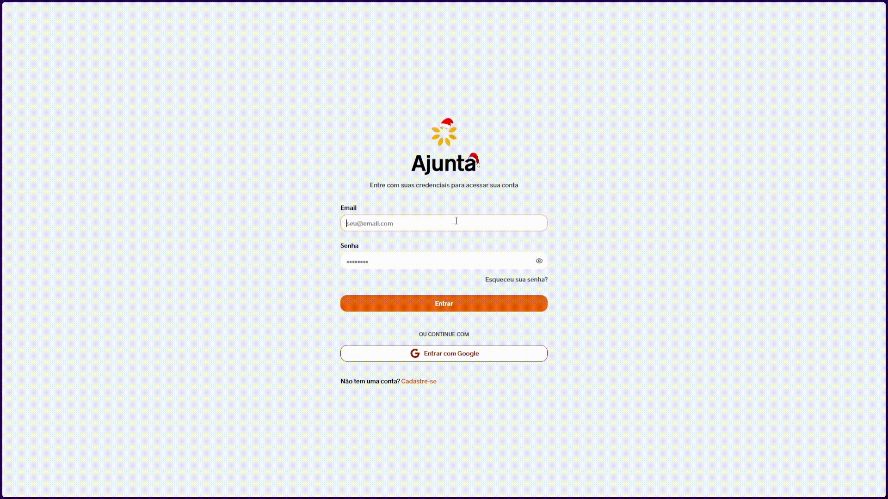
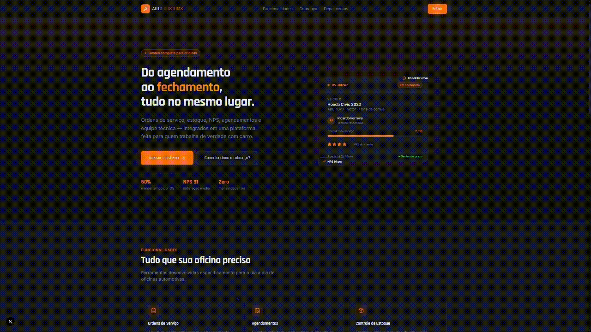

  <h1>
     Bem-vindo ao meu perfil!
  </h1>

## 👤 &nbsp;Sobre mim

Sou estudante de Engenharia de Software em Belo Horizonte – MG e gosto de construir aplicações web de ponta a ponta, do levantamento de requisitos e da modelagem até o back-end, o front-end e o deploy.

### Resumo rápido

- 🎓 Estudante de Engenharia de Software na PUC Minas
- 💻 Desenvolvedor full stack com Java/Spring Boot, Node.js, React

### Fale comigo

---

<picture>
  <source media="(prefers-color-scheme: dark)" srcset="https://raw.githubusercontent.com/GabrielReiiss/GabrielReiiss/output/pacman-contribution-graph-dark.svg">
  <source media="(prefers-color-scheme: light)" srcset="https://raw.githubusercontent.com/GabrielReiiss/GabrielReiiss/output/pacman-contribution-graph.svg">
  
</picture>

---

## 🚀 &nbsp;Projetos em destaque

> 🔒 Os projetos abaixo são forks privados de trabalhos acadêmicos de código-fonte fechado.

<table>
  <tr>
    <td align="center" width="50%">
      
      <h3>🎨 Ajunta</h3>
      
Rede social para artistas de Contagem - MG, conectando talentos, recrutadores e público.

      

        <code>Next.js</code> <code>React</code> <code>TypeScript</code> <code>Go</code> <code>Python</code> <code>GraphQL</code>
        <code>PostgreSQL</code> <code>RabbitMQ</code> <code>Docker</code> <code>AWS</code>
      

    </td>
    <td align="center" width="50%">
      
      <h3>🚗 AutoCustoms</h3>
      
Plataforma B2B2C que conecta clientes a serviços automotivos e oferece gestão modular para lojistas.

      

        <code>Flutter</code> <code>React</code> <code>TypeScript</code> <code>Go</code> <code>Python</code> <code>Terraform</code>
        <code>Docker</code> <code>AWS</code>
      

    </td>
  </tr>
</table>

### Outros projetos

| Projeto | Descrição | Stack |
|---|---|---|
| [**Portfolio**](https://github.com/GabrielReiiss/Portfolio) | Site de portfólio profissional responsivo, com linha do tempo de projetos e formulário de contato. [🔗 Ver online](https://portfolio-projeto-1-lab-desenvolvim-sable.vercel.app/) | Angular · ASP.NET |
| [**CarAlbum**](https://github.com/GabrielReiiss/CarAlbum) | Aplicação full stack para catalogar carros em um álbum. | Next.js · TypeScript · Spring Boot |
| [**SistemaRestaurante**](https://github.com/GabrielReiiss/SistemaRestaurante) | Gestão de restaurante: estoque, vendas, pagamentos e financeiro, com processos modelados. | JavaScript |
| [**sistema-gestao-olimpiadas**](https://github.com/GabrielReiiss/sistema-gestao-olimpiadas) | Modelagem de um sistema de gestão de competições olímpicas, com histórias de usuário e diagramas. | UML |

---

## ⭐️ &nbsp;Estatísticas

  
  

---

## 🛠 &nbsp;Tecnologias

### Back-end

### Front-end

### Banco de Dados

### Ferramentas & Versionamento

 

  

